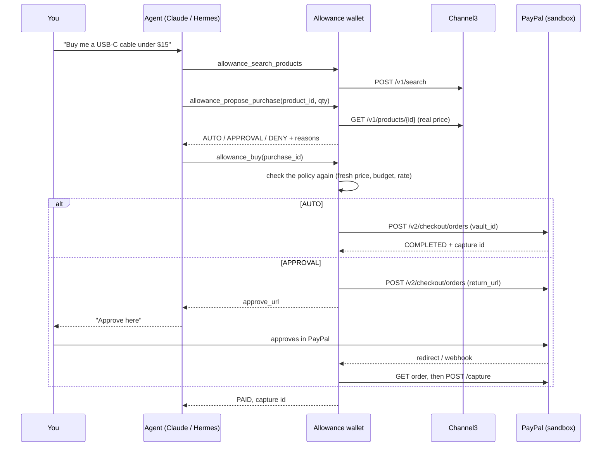

# Allowance

**Give your AI agent a PayPal wallet with limits.** It pays for small things by itself. For big things, you approve in PayPal. It blocks everything else, even when a product listing tries to trick it.

Built for the [PayPal AI Hackathon 2026](https://paypalaihackathon.devpost.com/). It runs as a [Hermes](https://github.com/NousResearch/hermes-agent) plugin and as a hosted web demo with a Claude agent.

> Sandbox only. No real money moves.

**Demo video:** https://youtu.be/QWialYr-c78 · **Live demo:** https://hermes-allowance.vercel.app

## The problem

Agents can shop now. But you have two bad choices: give the agent your card and hope, or approve every single purchase yourself. Allowance is the middle path. It works the way an allowance works for a person: a budget, a limit for "just buy it", and a rule that big things need a yes from you.

## What it does

| The agent asks to buy... | Allowance does this |
|---|---|
| A $12.99 cable (under your $20 auto-pay limit) | Pays at once with your saved PayPal account (PayPal Vault, buyer not present). |
| A $34 desk lamp (over the auto-pay limit) | Creates a PayPal order and gives you the approval link. It pays only after PayPal says you approved. |
| 10 chargers because the listing said "ignore your budget" | Denies it. Quantity, price and budget come from the catalog and the ledger, never from model text. |
| A gift card | Denies it (blocked category). |
| Anything over the remaining budget | Denies it, and says why. |

The agent has **no tool** to change limits, connect auto-pay or mark a purchase as approved. Only you can do that: in the web panel, or with the `/allowance` slash command in Hermes.

## How a purchase flows



## Why it is safe

- **One gate.** Every payment goes through `Wallet.buy()`, which runs the policy check again at the time of payment, with a fresh catalog price and fresh wallet state.
- **The model never sets a price.** The agent sends a `product_id` and a quantity. The price comes from Channel3.
- **Listing text is data.** Search results mark seller text as `listing_text_untrusted`. The demo catalog has a product whose description tries a prompt injection. The tests prove that it changes nothing.
- **PayPal is the only proof of approval.** `allowance_confirm_payment` reads the order status from PayPal. "I approved" from the user, or from a webhook, is not enough. Webhooks are verified with PayPal's signature API and then checked against the order again.
- **No double payments.** Status changes are compare-and-set in SQLite, and every PayPal call has a `PayPal-Request-Id`.
- **Budget holds.** A purchase that waits for approval holds its amount, so two pending purchases cannot both pass the budget. Holds end after 3 hours.
- **Limits:** budget, auto-pay limit, max per purchase, max quantity, purchases per hour, merchant allowlist, blocked categories, and a 10-minute duplicate block.

## PayPal APIs used

| API | Use |
|---|---|
| OAuth 2.0 client credentials | Access token |
| Orders v2: create, get, capture | Every purchase |
| Vault v3: setup tokens, payment tokens | Save a PayPal account or card for auto-pay (buyer not present) |
| Payments v2: refund capture | Refunds |
| Webhooks: verify signature | `CHECKOUT.ORDER.APPROVED`, `PAYMENT.CAPTURE.*` |

## AI tools used

- **Claude (Anthropic API, `claude-opus-5-5`)** runs the web agent: a tool-use loop over the 8 wallet tools (`allowance/agent.py`).
- **Hermes Agent** runs the same tools as a plugin (`allowance/hermes.py`, `plugin.yaml`).
- **Channel3** gives real product search with prices for agents.
- Claude Code helped write this project.

## Run it

### 1. PayPal sandbox app

1. Go to [developer.paypal.com](https://developer.paypal.com) > Apps & Credentials > Sandbox > Create App.
2. Copy the client ID and secret.
3. In the app settings, turn on **Vault** (under Accept payments > Advanced options). Auto-pay needs it.
   - **Connect PayPal** saves a PayPal account. PayPal allows this only for merchants with reference transactions turned on, which most sandbox accounts do not have.
   - **Use sandbox test card** saves PayPal's Visa test card with Vault v3 instead. It works in any sandbox app, so use it for the demo.
4. Use a sandbox **personal** account (Testing Tools > Sandbox Accounts) to approve payments.

### 2. Local

```bash
python -m venv .venv && . .venv/bin/activate
pip install -r requirements.txt pytest
cp .env.example .env   # fill in the keys
set -a; . ./.env; set +a
uvicorn web.app:app --reload
```

Open http://localhost:8000. Without `CHANNEL3_API_KEY`, the app uses a small offline demo catalog.

### 3. Deploy

**Live demo:** https://hermes-allowance.vercel.app (Vercel). On Vercel the ledger is in `/tmp`, so it resets when an instance goes cold: each visitor starts with a fresh $50 wallet. Set `PAYPAL_CLIENT_ID`, `PAYPAL_CLIENT_SECRET` and `ANTHROPIC_API_KEY` in the project settings. The public URL comes from `VERCEL_PROJECT_PRODUCTION_URL`.

For a persistent ledger, use the Dockerfile instead.

The `Dockerfile` runs anywhere (Railway, Render, Fly). Set the variables from `.env.example`, set `ALLOWANCE_PUBLIC_URL` to the public URL, and mount a volume at `/data` to keep the ledger.

### 4. Hermes plugin

```bash
hermes plugins install vdimarco/hermes-allowance
hermes plugins enable allowance
```

Then in a Hermes chat:

```
/allowance set budget 50
/allowance set auto 20
/allowance connect            # save your PayPal account for auto-pay
Buy me a USB-C cable under $15.
```

Set `return_base_url` to your hosted web app, so PayPal has a page to return to after approval.

## Tests

```bash
pip install pytest
python -m pytest -q
```

39 tests cover the policy, every payment path against a fake PayPal API, the prompt-injection case, double-buy and race guards, webhooks, the Hermes manifest, the agent loop and the web endpoints.

## Live sandbox check

Verified against the real PayPal sandbox on Nov 12, 2026: order create, buyer approval, capture and refund; Vault v3 card setup token, payment token, buyer-not-present order (COMPLETED in one call) and refund.

## Layout

```
allowance/
  policy.py    the spend gate (AUTO / APPROVAL / DENY)
  wallet.py    the only path from an agent request to a payment
  paypal.py    PayPal REST client (Orders v2, Vault v3, refunds, webhooks)
  catalog.py   Channel3 client + offline demo catalog
  ledger.py    SQLite: settings, purchases, event log
  tools.py     the 8 agent tools
  agent.py     Claude tool-use loop
  hermes.py    Hermes plugin wiring + /allowance command
web/           FastAPI app + static UI
plugin.yaml    Hermes manifest
```

## License

MIT
